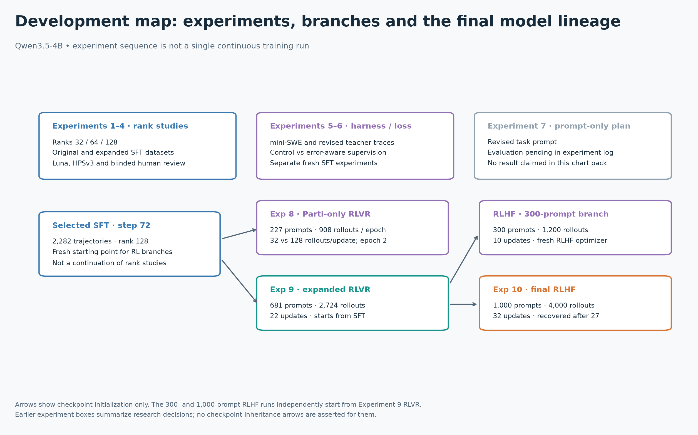
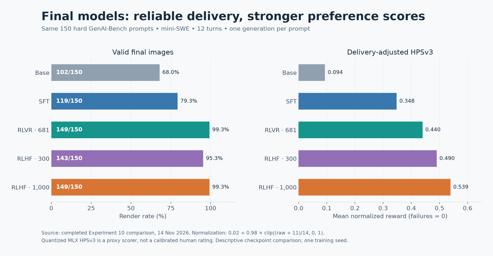
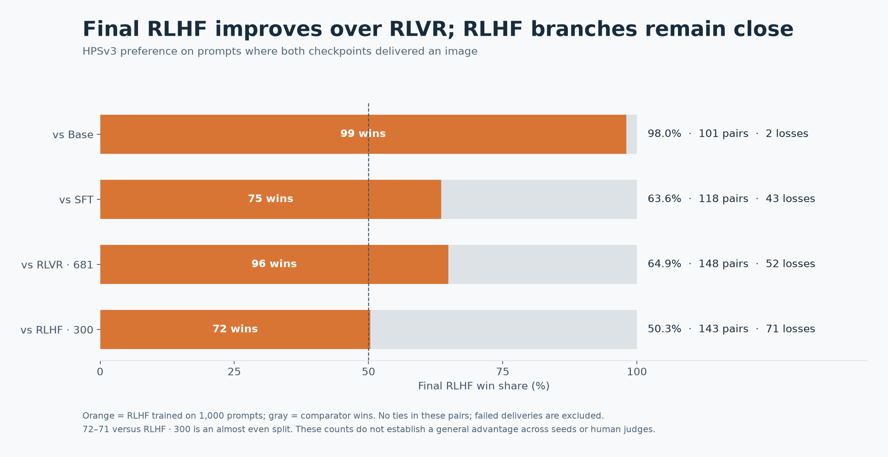
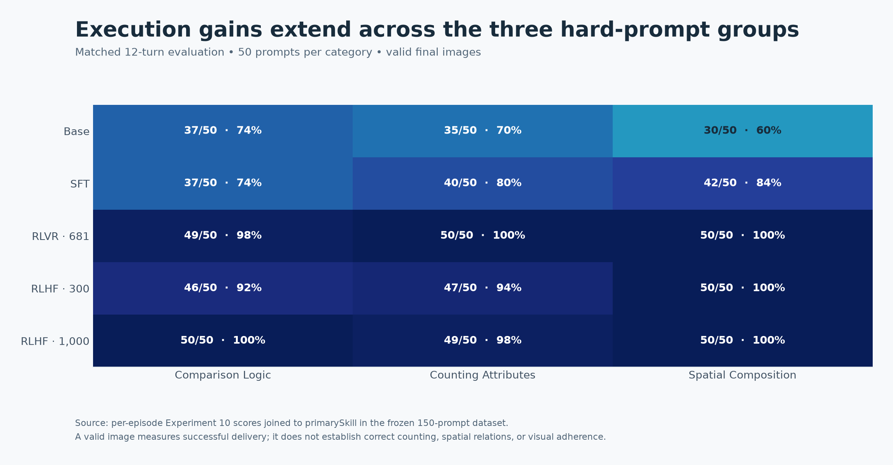
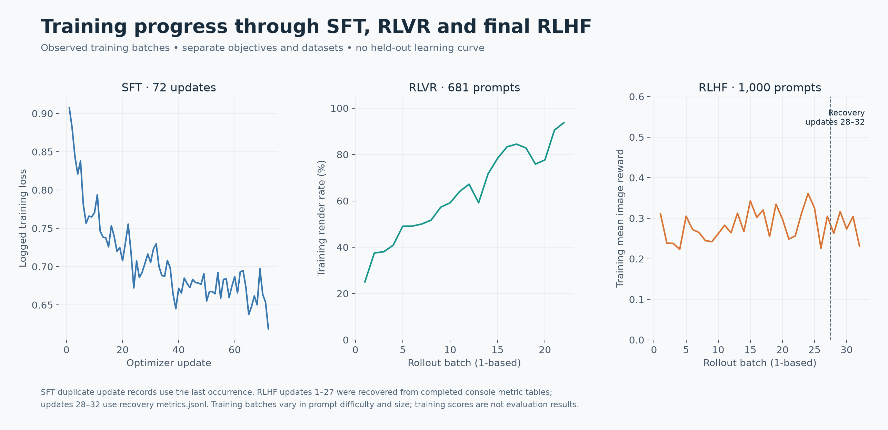
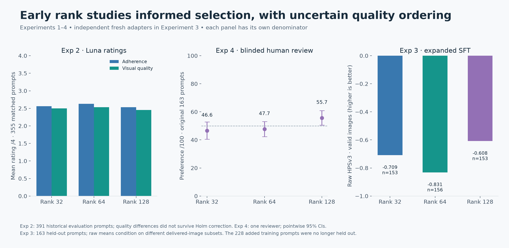
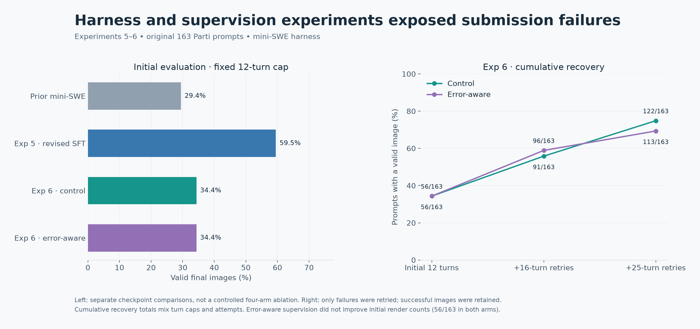
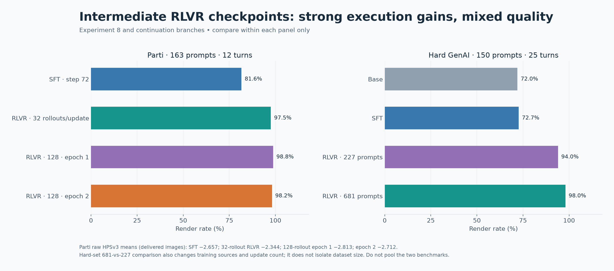

# Model development: supporting charts

Eight charts summarize the Qwen3.5-4B development experiments and the final SFT → RLVR → RLHF lineage. Each figure is available as a PNG for reports and an editable SVG for presentations. Numerical inputs and SHA-256 hashes of the source files are preserved in [data.json](data.json).

The final comparison uses the same **150 hard GenAI-Bench prompts, mini-SWE harness, and 12-turn cap** for all five checkpoints. It completed on November 14, 2026. The final 1,000-prompt RLHF checkpoint completed update 32 after optimizer-state recovery; the experiment log's earlier pending status predates those artifacts.

| Figure | What it supports | Files |
|---|---|---|
| 1. Final models | Delivery and normalized HPSv3 across base, SFT, RLVR, and both RLHF branches | [PNG](01-final-models.png) · [SVG](01-final-models.svg) |
| 2. Final paired preferences | Matched-image wins and losses; near-even comparison between RLHF branches | [PNG](02-final-pairwise.png) · [SVG](02-final-pairwise.svg) |
| 3. Category reliability | Delivery across counting/binding, spatial/composition, and comparison/logic | [PNG](03-category-reliability.png) · [SVG](03-category-reliability.svg) |
| 4. Training progress | Selected SFT loss, expanded RLVR render rate, and final RLHF reward | [PNG](04-training-progress.png) · [SVG](04-training-progress.svg) |
| 5. Early rank studies | Experiments 1–4: Luna ratings, original-model human review, expanded-data rank comparison | [PNG](05-rank-studies.png) · [SVG](05-rank-studies.svg) |
| 6. Harness and supervision | Experiments 5–6: revised SFT, error-aware masking, and staged failure retries | [PNG](06-harness-and-loss-masking.png) · [SVG](06-harness-and-loss-masking.svg) |
| 7. Intermediate RLVR | Experiment 8 batch sizes, second epoch, and Experiment 9 prompt expansion | [PNG](07-intermediate-rlvr.png) · [SVG](07-intermediate-rlvr.svg) |
| 8. Development map | Experiments 1–10, the planned Experiment 7, and checkpoint initialization branches | [PNG](08-development-map.png) · [SVG](08-development-map.svg) |

## Findings

- In the matched 12-turn final evaluation, valid deliveries increased from **102/150 for base** to **119/150 for SFT** and **149/150 for expanded RLVR**. Final RLHF retained **149/150**; the 300-prompt RLHF branch delivered **143/150**.
- Final RLHF's delivery-adjusted HPSv3 mean was **0.539**, compared with **0.440 for RLVR** and **0.490 for RLHF trained on 300 prompts**. These normalized rewards use `0.02 + 0.98 × clip((raw + 11) / 14, 0, 1)` for valid images and zero for failed deliveries.
- On shared delivered images, final RLHF beat RLVR **96–52** and SFT **75–43**. Its **72–71** split against 300-prompt RLHF is almost even. The higher aggregate mean does not imply a decisive pairwise quality advantage over that branch.
- Early LoRA studies did not establish a quality winner. Experiment 2 favored rank 64 descriptively; the blinded reviewer preferred rank 128 descriptively. The human preference tests remained inconclusive after correction.
- Experiment 6's error-aware loss mask produced the same initial render count as control (**56/163**). Later retry totals cannot be read as fixed-turn evaluation results.
- Intermediate RLVR comparisons show that execution reliability can improve without a corresponding increase in delivered-image HPSv3. More training or more prompts should not automatically be described as higher visual quality.

## Scope and interpretation

The figures cover the recorded research experiments, evaluated intermediate variants, and the final model lineage. They do not assign evaluation scores to every saved optimizer checkpoint. Experiment 7 has no completed result in the available experiment log and is shown as planned.

Benchmarks and harnesses changed during development. Original/expanded Parti evaluations, the hard GenAI-Bench set, fixed 12/25-turn runs, and cumulative retries are labeled separately. Results from those settings are not pooled into a single improvement curve. The 228 prompts moved into Experiment 3 training are not treated as held out for that experiment.

HPSv3 uses the pinned `mlx-4bit-g64-v1` implementation. It is a quantized proxy scorer, and it also supplies the RLHF training objective. Held-out scorer improvement is not independent human validation. Raw HPSv3 means exclude failed images and may condition on different prompt subsets; delivery-adjusted means include failures as zero. Older sigmoid-normalized HPSv3 results are not mixed with the final linear normalization.

Training curves describe changing training batches, not held-out checkpoint evaluation. Repeated SFT update records retain the last saved occurrence. Original final-RLHF metric files were removed during cleanup, so updates 1–27 come from completed console tables (six-decimal precision); updates 28–32 come from the recovery metrics. The recovery manifest's 544 episodes count only the remaining rollout work; the complete run planned 4,000 rollouts.

Each comparison has one trained checkpoint per setting and one generation per evaluation prompt. The final results are descriptive; these charts introduce no new significance tests. The early human-review confidence intervals are the existing pointwise prompt-bootstrap intervals from Experiment 4.

## Sources and reproduction

Historical table values come from [EXPERIMENT_LOG.md](../../EXPERIMENT_LOG.md), particularly Experiments 2–6. Completed local comparison JSON files provide the newer evaluation results. The snapshot records the exact source paths and file hashes; raw datasets, checkpoints, and evaluations are Git-ignored and are not required to redraw the charts.

From the repository root, using Python with Matplotlib and NumPy:

```sh
python scripts/chart_model_development.py
```

Or use an isolated dependency environment:

```sh
uv run --no-project --with matplotlib==3.11.2 python scripts/chart_model_development.py
```

To rebuild the snapshot from the original local sources and validate final per-episode delivery counts and reward means:

```sh
python scripts/chart_model_development.py --refresh-data
```

The generator is [scripts/chart_model_development.py](../../scripts/chart_model_development.py). Refreshing uses local saved data and makes no model calls.

## Gallery
















