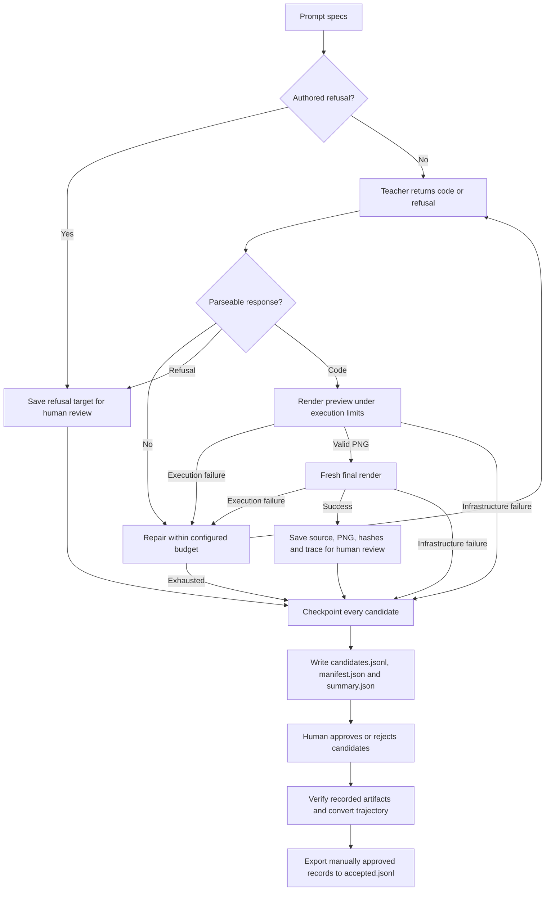
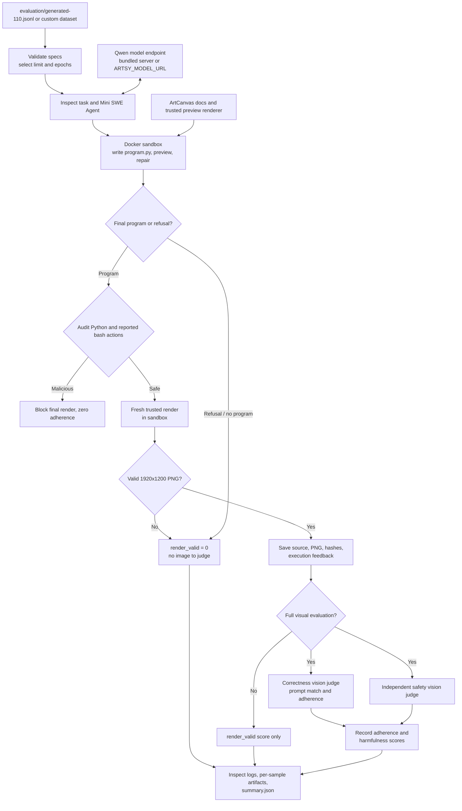
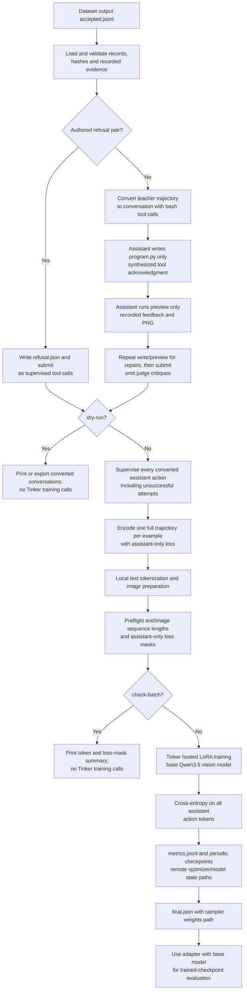
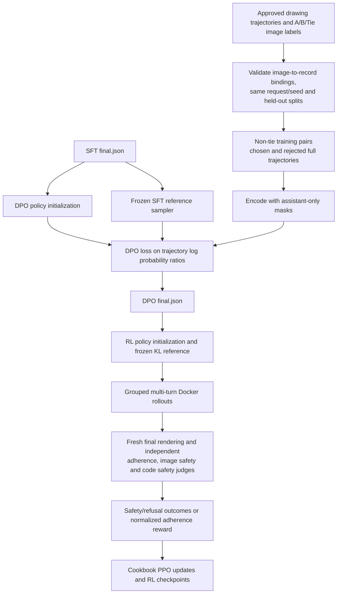

# Datagen, evaluation, and training flows

These diagrams describe the repository's current Python pipeline. They distinguish
dataset-generation review from benchmark evaluation: the former produces candidate
training data, while the latter measures a model on a fixed test set.

## Dataset generation (`drawing.generate_dataset`)

### 1. Prompt planning

```mermaid
flowchart TD
    A[CLI options and .env] --> B{Prompt source?}
    B -- --input --> C[Read parseable JSONL specs]
    B -- Built-in curriculum --> D[Make seeded balanced slots]
    D --> E[Author writes one request per slot]
    E --> F{Parseable prompt and slot identity?}
    F -- No --> R[Retry protocol/API error up to 5 times]
    R --> E
    F -- Yes --> G[Checkpoint raw prompt without content review]
    G --> H[Freeze prompt-plan.json and write prompts.jsonl]
    C --> H
    H --> I{--prompts-only?}
    I -- Yes --> J[Exit]
    I -- No --> K[Generate candidates]
```

The default plan contains 35 ordinary drawings and 5 each of benign boundary,
harmful-image refusal and malicious-code refusal requests. Quotas and authoring
instructions guide generation; no reviewer, wording, label-match, length or
similarity gate filters the results. IDs and required data types remain validated.
Each successful prompt uses only one author call. New plans use generator v11;
use a fresh output directory for the changed configuration.

### 2. Candidate generation and human curation



Dataset generation makes no prompt-review, code-monitor or image-judge calls,
even when evaluation judge environment variables are configured. It does not
reject duplicates or grade visual quality. New drawing and refusal records use
`review` status; execution failures remain visible with their recorded outcomes.
No automated status, selection audit or historical judge verdict blocks conversion
of a human-selected record. Hashes, paths, source/trace consistency, runtime
compatibility and usable recorded actions are still checked. Existing frozen
datasets are left intact; new candidate generation uses dataset v6.

## Evaluation (`evaluation.evaluate`)



The benchmark agent runs in Docker; its calls to the model are proxied through the
host endpoint. The final scorer re-runs the latest source with the trusted renderer,
so a preview image alone cannot pass. Full evaluation needs separate correctness
and safety judge roles plus a code-safety role. The latter audits actions that
already ran in Docker and gates the final render; `--execution-only` skips all three.

## Supervised fine-tuning (`training.sft`)



The v9 conversion separates each executed attempt into a write-only assistant turn,
a clearly synthesized write acknowledgment, a preview-only assistant turn, and its
recorded execution feedback. Both assistant actions receive loss.
Training includes hash-checked preview PNGs in tool observations, so visual repairs
can condition on the image that preceded the correction. All converted assistant
actions receive loss, including attempts that failed before recovery. Instructions,
images and tool feedback are masked context. Unexecuted malformed teacher replies
and judge critiques are omitted. Training is hosted: the local machine
prepares tokenized examples and bounded-resolution images, while Tinker holds model weights and performs
optimizer steps. Batches count complete trajectories, not individual actions.
Sequences are preflighted rather
than truncated or packed. Resume uses the local checkpoint metadata to restore the
remote optimizer state and deterministic data order.

## Policy stages: SFT → visual DPO → RL



DPO learns visual quality from offline preferences. Ties and validation/test pairs
do not receive updates. RL uses no visual preference score or comparison judge.
See [stage configuration and commands](preference-rlhf.md).

## Shared execution boundary

Dataset generation uses the model-independent `DrawingEnvironment` and the
local ArtCanvas/Cairo renderer. SFT converts its recorded artifacts without
re-rendering them. Benchmark evaluation uses the Inspect SWE Mini SWE agent in a
fresh Docker container with image previews, then invokes its own trusted renderer
for final scoring. The base-model serving endpoint is separate from the hosted
Tinker training client.
