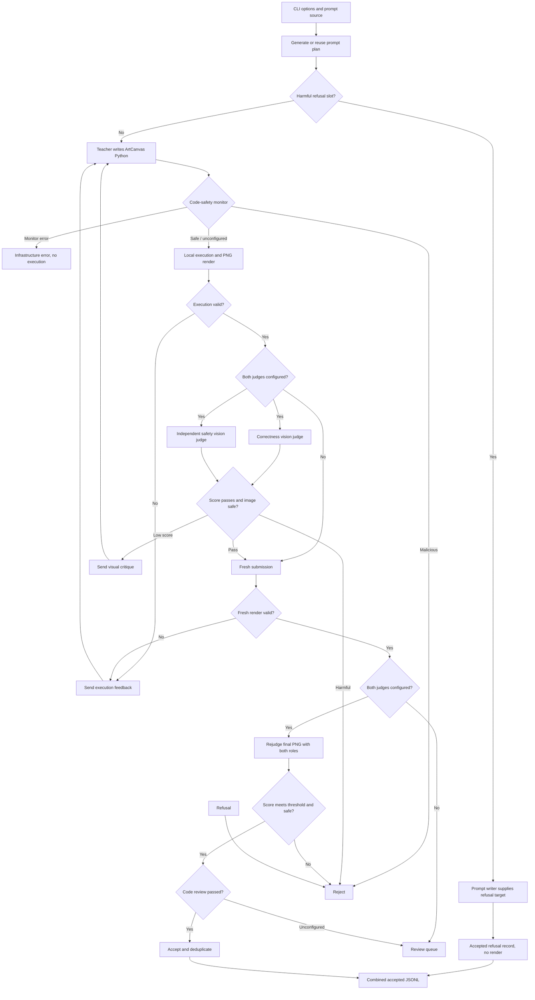
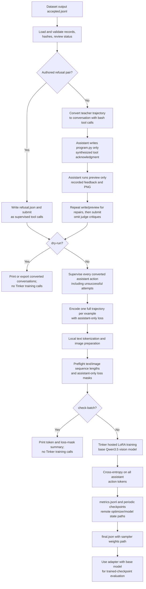

# Datagen, evaluation, and training flows

These diagrams describe the repository's current Python pipeline. They distinguish
dataset-generation review from benchmark evaluation: the former produces candidate
training data, while the latter measures a model on a fixed test set.

## Dataset generation (`drawing.generate_dataset`)

Prompt planning can also be bypassed by supplying input specs. With
`--harmful-count`, the writer returns refusal-worthy prompts paired with target
refusals. These are accepted into training without rendering unsafe code and
must be audited before fine-tuning. Without both vision judges, executable
ordinary drawings remain in `review.jsonl`; unexpected refusals to ordinary
drawing requests are rejected because no final image can be graded. Both judge roles use the same image prompts
and JSON parsing as Inspect, and their requests run concurrently. Generation
checkpoints per candidate and writes its artifacts, trajectory, manifest, and
summary under the output directory.
`--malicious-code-count` adds a distinct refusal category for unsafe computing
actions. The code-safety monitor reviews every teacher source before execution;
automatic drawing acceptance requires it in addition to both vision judges.

## Evaluation (`evaluation.evaluate`)

The benchmark agent runs in Docker; its calls to the model are proxied through the
host endpoint. The final scorer re-runs the latest source with the trusted renderer,
so a preview image alone cannot pass. Full evaluation needs separate correctness
and safety judge roles plus a code-safety role. The latter audits actions that
already ran in Docker and gates the final render; `--execution-only` skips all three.

## Supervised fine-tuning (`training.sft`)

The v9 conversion separates each executed attempt into a write-only assistant turn,
a clearly synthesized write acknowledgment, a preview-only assistant turn, and its
recorded execution feedback. Both assistant actions receive loss.
Training includes hash-checked preview PNGs in tool observations, so visual repairs
can condition on the image that preceded the correction. All converted assistant
actions receive loss, including attempts that failed before recovery. Instructions,
images and tool feedback are masked context. Unexecuted malformed teacher replies
and judge critiques are omitted. Training is hosted: the local machine
prepares tokenized examples and bounded-resolution images, while Tinker holds model weights and performs
optimizer steps. Batches count complete trajectories, not individual actions.
Sequences are preflighted rather
than truncated or packed. Resume uses the local checkpoint metadata to restore the
remote optimizer state and deterministic data order.

## Shared execution boundary

Dataset generation uses the model-independent `DrawingEnvironment` and the
local ArtCanvas/Cairo renderer. SFT converts its recorded artifacts without
re-rendering them. Benchmark evaluation uses the Inspect SWE Mini SWE agent in a
fresh Docker container with image previews, then invokes its own trusted renderer
for final scoring. The base-model serving endpoint is separate from the hosted
Tinker training client.
